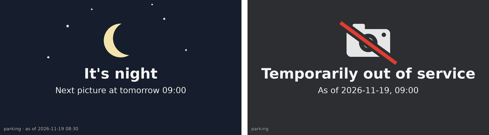

# Tapo Webcam @quax76

**Turn a Tapo camera into a public webcam – even battery cameras without RTSP, and even when the
camera is somewhere else entirely.**

The service grabs a still picture at fixed intervals, makes faces unrecognisable, shrinks the picture,
strips all metadata and uploads it to your web server via SFTP. At night visitors see an "It's night"
picture; during outages or when the battery is low they see a neutral "Temporarily out of service" –
without learning the reason.

* **No RTSP/ONVIF needed:** battery cameras such as C410/C420/C425/C460, doorbell D230, cameras paired to an H200/H500 hub
* **No device on site:** access through the TP-Link cloud relay, like the Tapo app on the go – or locally in the LAN
* **Privacy built in:** face detection with pixelation, fail-safe, the original picture is never stored
* **Battery friendly:** time windows, battery reading without extra wake-ups, automatic pauses
* **Easy to run:** one Python service, systemd or Docker, one TOML file



## How it works

```
Tapo camera ──(cloud relay or LAN)──► still picture ──► pixelate faces ──► resize,
strip metadata ──► archive + latest.jpg ──► SFTP upload ──► your website
                                       └─► HTTP API for dashboards / ioBroker
```

One picture every 15 minutes (configurable), only within the desired time window, e.g. 09:00–19:00.

## Features

| Area | What happens |
|---|---|
| **Capture** | Locally in the LAN (pytapo, port 8800) or through the TP-Link cloud (ontapo). Free interval, only within a time window (`active_hours`, `active_days`). |
| **Privacy** | Face detection with OpenCV YuNet and pixelation, resizing to `max_width`, optional blur, EXIF/metadata dropped. The original is never stored. |
| **Battery protection** | The battery level is read after every picture (the camera is awake anyway). Below `battery_min` captures pause. |
| **Publishing** | SFTP upload (atomic: `.tmp` first, then rename). HTTP API with `latest.jpg`, `snapshot.jpg`, event triggers and `/status`. |
| **Placeholders** | At night an "It's night" picture with the next capture time; during outages or battery pauses a neutral "Temporarily out of service" – without revealing the reason. English or German texts. |
| **Archive** | Daily folders `YYYY/MM/DD/HHMMSS.jpg`, automatic deletion after `retention_days`. |
| **Integration** | systemd service or Docker, script for ioBroker. |

## Quick start (Debian/Ubuntu, systemd)

```bash
git clone https://github.com/quax76/TapoWebcam.git tapo-webcam
cd tapo-webcam
sudo bash install.sh

# Cloud access (camera at a remote site):
sudo -u tapo-webcam /opt/tapo-webcam/venv/bin/python /opt/tapo-webcam/tapo_webcam.py \
     cloud-login -c /etc/tapo-webcam/config.toml

sudo vi /etc/tapo-webcam/config.toml          # cloud_device, time window, upload …
sudo -u tapo-webcam /opt/tapo-webcam/venv/bin/python /opt/tapo-webcam/tapo_webcam.py \
     snap -c /etc/tapo-webcam/config.toml -o /var/lib/tapo-webcam/test.jpg -v
sudo systemctl enable --now tapo-webcam
```

Web interface: `http://<server>:8099/`

Minimal configuration for a cloud camera with upload:

```toml
output_dir         = "/var/lib/tapo-webcam/images"
cloud_session_file = "/var/lib/tapo-webcam/cloud_session.json"

[defaults]
active_hours = "09:00-19:00"
max_width    = 1280
face_blur    = true
battery_min  = 30
placeholders = true
language     = "en"            # or "de"

[upload]
host = "ssh.example.com"
user = "webcam"
key  = "/var/lib/tapo-webcam/.ssh/sftp_ed25519"
dir  = "html/webcam"
name = "webcam.jpg"

[[camera]]
name         = "parking"
connection   = "cloud"
cloud_device = "Parking"       # name as in the Tapo app
interval     = 900
timeout      = 30
```

All options: [Configuration](docs/configuration.md).

## Documentation

| Chapter | Contents |
|---|---|
| [Installation](docs/installation.md) | systemd, Docker, cloud sign-in, update, uninstall, system requirements |
| [Configuration](docs/configuration.md) | Complete reference of all options with defaults and examples |
| [Features in detail](docs/features.md) | Capture methods, time windows, face detection, battery protection, SFTP upload, placeholders |
| [HTTP API and ioBroker](docs/api.md) | All endpoints, `/status` fields, ioBroker script, VIS, embedding in a website |
| [Operations and troubleshooting](docs/operations.md) | Commands, log messages, common errors and fixes |
| [Architecture](docs/architecture.md) | Code structure, flow of a capture, files and permissions |
| [Privacy and security](docs/privacy.md) | What is stored, secrets, hardening |
| [Changelog](CHANGELOG.md) | Version history |

## Project files

```
tapo_webcam.py         main program (CLI + service + HTTP API)
tapo_cloud_auth.py     sign-in/token refresh for the Tapo cloud account
tapo_faces.py          face detection and pixelation (OpenCV YuNet)
models/                YuNet model (ONNX)
config.example.toml    commented example configuration
install.sh             installation as a systemd service
tapo-webcam.service    systemd unit (hardened)
Dockerfile, docker-compose.yml
iobroker/              script for the ioBroker JavaScript adapter
docs/                  detailed documentation
```

## Tested with

* Tapo **C460** (battery, 4K) through the cloud, Ubuntu 24.04 in a VM (2 GB RAM), upload to a web host
  via SFTP.
* Other models should work as long as the Tapo app shows a live view. Feedback is welcome.

## Notes

* Cloud access uses the unofficial library [ontapo](https://pypi.org/project/ontapo/) and a re-implemented
  app sign-in. TP-Link does not intend this kind of use; changes to the app or the cloud can break access
  at any time. Use at your own risk.
* Every capture wakes a battery camera. Intervals below 10 minutes noticeably reduce battery life.
* If you run a public webcam you are responsible for complying with privacy law (e.g. GDPR) yourself –
  see [Privacy](docs/privacy.md).
